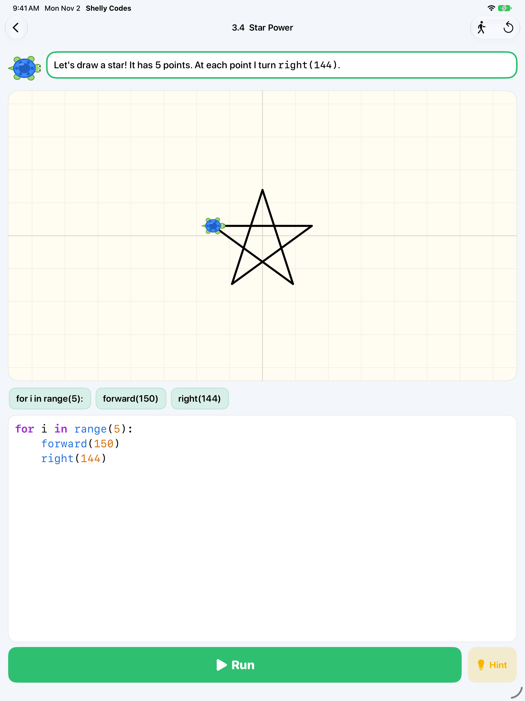

# Shelly Codes

An iPad app that teaches kids aged 8 to 12 to write **real Python**. Children type
code, tap Run, and watch Shelly the turtle walk, turn and draw exactly what they
wrote.



- **27 levels in 6 chapters:** moving and turning, print and variables, for loops,
  colors and pens, lists/if/while, and functions. Two levels start with a bug to fix.
- **Friendly mistakes:** errors are explained in plain words on the line where they
  happen ("Add a colon : at the end of this for line.", "Did you mean forward?").
- **Motivation:** up to 3 stars per level (solved, short code, no hints), shell colors
  to unlock, confetti.
- **Free Draw:** a studio for making anything, starting from ideas or a blank page.
- **Built for kids:** iPad only, no ads, no purchases, no accounts, no tracking, works
  offline. A parental gate guards the Grown-ups area.

## How it works

Shelly runs a kid-sized Python 3 written in Swift (`ShellyCodes/Python/`): a lexer
with indentation, a parser, and a tree-walking interpreter. It supports variables,
numbers, text, lists, `for`/`while`, `if`/`elif`/`else`, `def`/`return`/`global`,
`import`, and the commands from Python's `turtle` module (`forward`, `left`,
`circle`, `color`, `begin_fill`, `goto`, `dot`, `write`, …). Code that runs here runs
in real Python too. A run finishes first and records Shelly's moves, then the canvas
replays them as an animation. Limits on steps, moves, recursion and output stop
runaway programs with a friendly message.

Levels live in `ShellyCodes/Game/Curriculum.swift`. Each level is checked against the
drawing and output of its own solution, so the dotted target and the expected output
can't drift out of sync.

Built with the [easy-ios](https://github.com/polyglot-learn/easy-ios) defaults:
SwiftUI, iOS 17, SwiftData, Swift Testing, XCUITest, no third-party packages.

## Develop

```sh
make test         # unit and UI tests on an iPad simulator
make unit         # unit tests only
make lint         # swift-format (run make format first)
make screenshots  # App Store screenshots, 13-inch iPad
make icon         # redraw the app icon
make listing      # check APP_STORE.md against App Store limits
```

Open `ShellyCodes.xcodeproj` in Xcode and run on an iPad simulator.

## Publish

See [APP_STORE.md](APP_STORE.md) for the listing text, privacy answers, review notes
and a step-by-step release checklist. The privacy policy and support page are in
`docs/`, served by GitHub Pages.

## License

MIT
